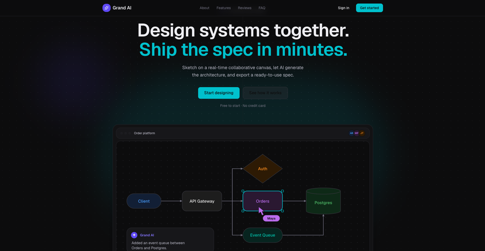
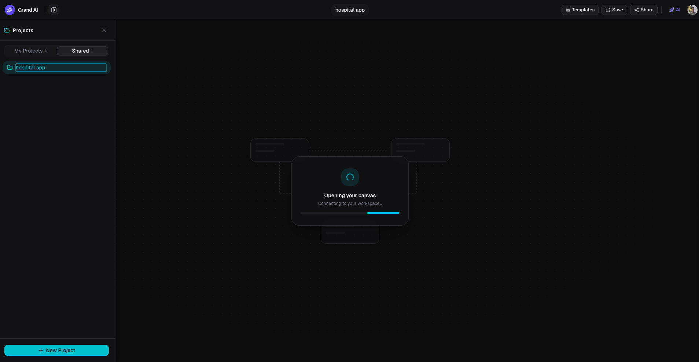
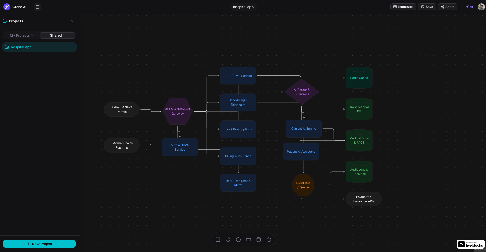
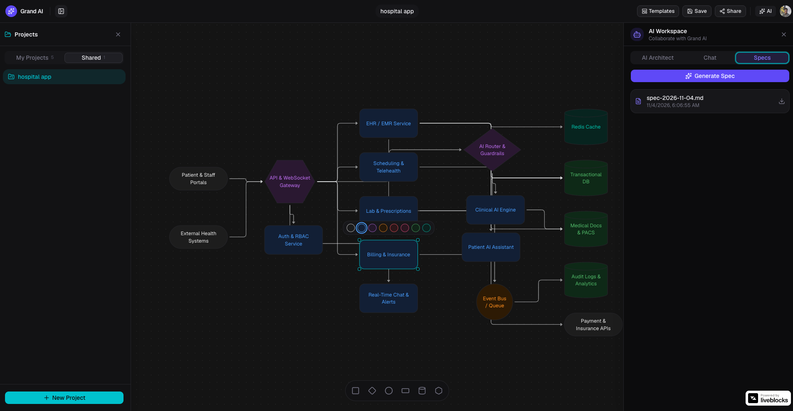
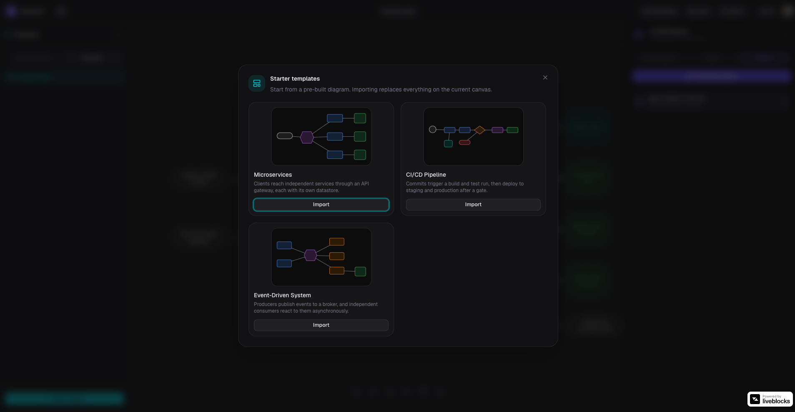
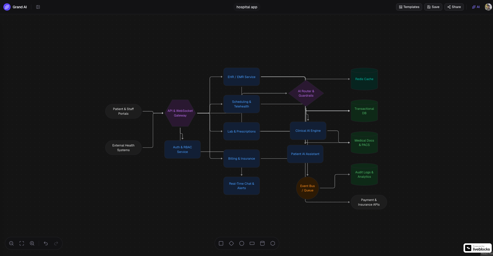

# GRAND AI: AI SYSTEM DESIGN WORKSPACE

## Overview

Grand AI is a real-time collaborative system design workspace built with Next.js, React, TypeScript, and Tailwind CSS. Describe a system in plain English and an AI agent lays it out on a shared canvas. Your team refines the architecture together, and Grand AI turns the final graph into a downloadable Markdown technical specification.

Heavy AI work runs as durable background tasks on Trigger.dev, so generation survives page reloads and streams progress back to the editor live.

## Screen Snapshots

<p float="left">
  
  
  
  
  
  
</p>

1. **Landing page:** hero with a live canvas preview showing collaborator cursors and Grand AI edits.
2. **Projects sidebar:** "My Projects" and "Shared" tabs while the canvas connects.
3. **Shared canvas:** an AI-generated hospital app architecture.
4. **AI Workspace:** AI Architect, Chat, and Specs tabs, with Generate Spec and downloadable specs, plus the node color picker.
5. **Starter templates:** Microservices, CI/CD Pipeline, and Event-Driven System.
6. **Canvas controls:** zoom, fit, undo/redo, and the shape toolbar.

Demo Link: [Grand AI](https://system-design-ai-murex.vercel.app/)

## Features

- Next.js 16 App Router app styled with Tailwind CSS 4 and written in TypeScript
- Landing page with hero, features, reviews, and FAQ sections
- Authentication and route protection with Clerk
- Project management with an owner plus invited collaborators (by email)
- Real-time shared canvas built on React Flow and Liveblocks, with live cursors and presence avatars
- Six node shapes (rectangle, diamond, circle, pill, cylinder, hexagon), colors, labeled edges, and canvas autosave
- Starter system design templates that can be imported into the canvas at any time
- AI architect: a prompt becomes nodes and edges on the canvas, with Grand AI shown as a participant in the room
- Team chat and AI chat in the editor sidebar
- Spec generation: the canvas and chat history become a Markdown technical spec, stored in Vercel Blob and downloadable
- Gemini models via the Vercel AI SDK, with automatic fallback to other models when the primary one is overloaded or rate limited
- Error and performance monitoring with Sentry
- Daily cron job that cleans up orphaned Liveblocks rooms

## Tech Stack

| Area | Technology |
| --- | --- |
| Framework | Next.js 16, React 19, TypeScript |
| Styling | Tailwind CSS 4, shadcn/ui, Base UI |
| Auth | Clerk |
| Database | PostgreSQL with Prisma 7 |
| Realtime canvas | Liveblocks, React Flow (`@xyflow/react`) |
| Background jobs | Trigger.dev v4 |
| AI | Vercel AI SDK with Google Gemini |
| File storage | Vercel Blob (canvas snapshots and specs) |
| Monitoring | Sentry |
| Hosting | Vercel (including cron) |

## How It Works

1. A signed-in user creates or opens a project in the editor.
2. The canvas syncs between collaborators through Liveblocks.
3. A prompt sent to the AI architect triggers the `design-agent` task, which writes nodes and edges into the shared room.
4. Generating a spec triggers the `generate-spec` task, which writes Markdown to Vercel Blob and records it in the database.
5. The browser follows each run in real time with Trigger.dev realtime hooks, using short-lived tokens issued after an ownership check.

## Project Structure

```
app/
  page.tsx                  Landing page
  (auth)/                   Clerk sign-in and sign-up
  editor/                   Project list and workspace (editor/[roomId])
  api/
    projects/               Project, collaborator, canvas, and spec routes
    ai/design, ai/spec      Trigger the AI tasks and issue run tokens
    liveblocks-auth/        Liveblocks authentication
    cron/liveblocks-cleanup Daily room cleanup
components/
  editor/                   Canvas, sidebar, dialogs, templates, presence
  landing/                  Landing page sections
  ui/                       shadcn/ui primitives
trigger/                    Background tasks (design-agent, generate-spec)
prisma/                     Schema (split into models/) and migrations
lib/                        Prisma client, access checks, storage, Sentry helpers
context/                    Product, architecture, and feature specs
```

## Getting Started

### Prerequisites

- Node.js 20 or later
- A PostgreSQL database
- Accounts for Clerk, Liveblocks, Trigger.dev, Vercel Blob, Google AI Studio, and (optionally) Sentry

### Installation

```bash
npm install
```

`postinstall` runs `prisma generate` for you.

### Environment variables

Create a `.env.local` file in the project root:

```bash
# Clerk
NEXT_PUBLIC_CLERK_PUBLISHABLE_KEY=
CLERK_SECRET_KEY=
NEXT_PUBLIC_CLERK_SIGN_IN_URL=/sign-in
NEXT_PUBLIC_CLERK_SIGN_UP_URL=/sign-up
NEXT_PUBLIC_CLERK_SIGN_IN_FALLBACK_REDIRECT_URL=/editor
NEXT_PUBLIC_CLERK_SIGN_UP_FALLBACK_REDIRECT_URL=/editor

# Database
DATABASE_URL=

# Liveblocks
LIVEBLOCKS_PUBLIC_KEY=
LIVEBLOCKS_SECRET_KEY=

# Vercel Blob
BLOB_READ_WRITE_TOKEN=

# Trigger.dev
TRIGGER_SECRET_KEY=

# Google Gemini
GOOGLE_AI_API_KEY=

# Sentry (optional)
NEXT_PUBLIC_SENTRY_DSN=
SENTRY_DSN=
SENTRY_ORG=
SENTRY_PROJECT=
SENTRY_AUTH_TOKEN=
```

The Trigger.dev tasks run on Trigger.dev's infrastructure, so `LIVEBLOCKS_SECRET_KEY`, `GOOGLE_AI_API_KEY`, `DATABASE_URL`, and `BLOB_READ_WRITE_TOKEN` must also be set in your Trigger.dev project's environment variables.

### Database

```bash
npx prisma migrate dev
```

### Run the app

Start the Next.js dev server and the Trigger.dev dev worker in two terminals:

```bash
npm run dev
```

```bash
npx trigger.dev@latest dev
```

Open [http://localhost:3000](http://localhost:3000) with your browser to see the result.

## Scripts

| Command | Description |
| --- | --- |
| `npm run dev` | Start the Next.js dev server |
| `npm run build` | Generate the Prisma client and build for production |
| `npm run start` | Run the production build |
| `npm run lint` | Lint with ESLint |

## Deployment

Deploy the Next.js app to [Vercel](https://vercel.com/new) and set the environment variables above. [vercel.json](vercel.json) registers a daily cron (`0 3 * * *`) that calls `/api/cron/liveblocks-cleanup`. Deploy the background tasks with `npx trigger.dev@latest deploy`.

## Learn More

- [Next.js Documentation](https://nextjs.org/docs)
- [Clerk](https://clerk.com/docs), [Liveblocks](https://liveblocks.io/docs), [Trigger.dev](https://trigger.dev/docs), [Prisma](https://www.prisma.io/docs)
- [Vercel AI SDK](https://ai-sdk.dev/docs)
